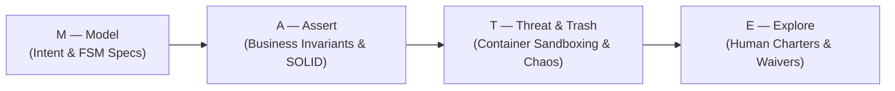

<div align="center">

# 🧉 M.A.T.E.
### Modern AI Testing Ecosystem · Model-Agnostic Test Engineering
**Spec-Driven Testing (SDT) Framework & Daily Quality Companion for the Agentic AI Era**

[](https://www.npmjs.com/package/mate-sdt)
[](https://opensource.org/licenses/MIT)
[](https://www.typescriptlang.org/)
[](https://playwright.dev/)

<br/>

[**Quickstart**](#-quick-start) •
[**Why M.A.T.E.?**](#-why-mate) •
[**The 4 Pillars**](#-the-4-core-pillars) •
[**20 Specialized Skills**](#-the-20-skills-ecosystem) •
[**8 E2E Workflows**](#-8-end-to-end-sdt-workflows) •
[**5-Gate Harness**](#-5-gate-closed-loop-verification) •
[**Manifesto**](https://github.com/mate-sdt/mate-sdt/blob/main/MANIFESTO.md)

</div>

---

## 💡 What is M.A.T.E.?

Frontier AI reasoning models (**Claude Sonnet, Opus 5.5 & Fable 5.2**, **OpenAI GPT-6 / GPT-5.6 series**, **Google Gemini 4**, and **DeepSeek V4**) and autonomous coding environments (**Claude Code**, **Cursor**, **Windsurf**, **Google Antigravity**, **GitHub Copilot**, and **OpenAI Codex CLI**) are extraordinary at algorithmic problem-solving, architectural reasoning, and feature development. 

However, when tasked with **Software Quality & Test Automation**, reasoning models alone suffer from predictable, catastrophic failure modes:

* 🚨 **Selector Guesswork & Spec Drift:** Models hallucinate unstable selectors or leak raw `page.locator()` calls directly inside spec files, creating unmaintainable spaghetti.
* 🎭 **Test Greenwashing:** Agents generate tautological assertions (`expect(true).toBe(true)`, mocking away critical boundaries, or weakening assertions) just to turn the CI pipeline green.
* 🌀 **Context Poisoning & Rot:** Without structured external memory, agents drown in 80,000-token HTML dumps and invent business rules (`[INFERRED]` masquerading as truth).
* 🩹 **Anti-Patterns & Flakiness:** Models default to arbitrary sleeps (`waitForTimeout`), missing auto-waits, and tight coupling without Page Object encapsulation.

**M.A.T.E. (Model, Assert, Threat, Explore)** solves this by enforcing:
$$\text{Agent} = \text{Model} + \text{Harness} + \text{Knowledge}$$

1. **Context Engineering (_Write, Select, Compress, Isolate_):** Living architecture in `MATE-PROJECT-MAP.md` (`< 3,000` tokens), JIT Context Packs (`npx mate-sdt context`), compact ARIA snapshots (`< 800` tokens via `@playwright/cli`), and sub-agent isolation (`--subagent <skill>`).
2. **Harness Engineering & Closed-Loop Verification:** A deterministic **5-Gate Closed Verification Loop (`npx mate-sdt gate --loop`)** with self-correction, containerized sandboxing, AST linting, and continuous doc-gardening (`npx mate-sdt gc`).

---

## ⚡ Quick Start

Bootstrap M.A.T.E. in any TypeScript or JavaScript Playwright project with zero configuration:

```bash
# Interactive zero-config installer
npx mate-sdt install

# Install with Playwright CLI & browser harness dependencies
npx mate-sdt install --with-playwright-cli

# Install with on-demand AI Quality Pack (Promptfoo, DeepEval & OTel Traces)
npx mate-sdt install --with-ai-evals
```

The interactive CLI:
1. Detects project type (standalone QA repository vs. integrated app repo).
2. Distributes native instructions across your IDEs (`.agents/skills/` for Antigravity, `.claude/`, `.cursor/rules/`, `.windsurf/`, `.github/prompts/`, and universal `AGENTS.md`).
3. Scaffolds the active `.mate/` protocol (`.mate/exec-plans/`, `.mate/sessions/`, `.mate/memory/`, and `docs/QUALITY_SCORE.md`).
4. Configures Forward-Only 6-Layer Architecture (`src/models/` ➔ `src/api/` & `src/components/` ➔ `src/pages/` ➔ `src/fixtures/` ➔ `tests/`).

---

## 🏛 The 4 Core Pillars

The **M.A.T.E.** acronym defines the four non-negotiable layers of Spec-Driven Testing:



### 1. 🗺️ M — Model (Intent, State Machines & Forbidden Transitions)
Testing begins before code is drafted. Functional requirements and workflows are formally modeled in `specs/*.mate-spec.md` with explicit Finite State Machines (FSM), typed contracts, and **strictly forbidden transitions** where 90% of critical exploits hide.

### 2. 🎯 A — Assert (Deterministic Oracles & Business Invariants)
A test that does not validate a domain invariant is merely an illusion to paint the pipeline green. M.A.T.E. enforces:
* **Business Invariants:** Deterministic domain rules that must never be violated (permissions, financial integrity, state contracts).
* **The `MATE-ANTI-08` Rule:** **Zero raw locators or navigation inside `.spec.ts` files.** All interactions live strictly inside `BasePage` and `BaseComponent` objects injected via `test.extend` fixtures (DIP).
* **Anti-Greenwashing Mandate:** When a real defect is discovered, agents must never weaken the assertion; they preserve the true spec oracle, mark it with `test.fail(true, 'BUG-XXX')`, and generate a formal defect report via `npx mate-sdt bug`.
* **Pragmatic Classification:** Evaluates scenarios across `[AUTOMATE_UI]`, `[AUTOMATE_API]`, `[MANUAL_TEST]`, and `[EXPLORATORY_CHARTER]`.

### 3. 💥 T — Threat & Trash (Container Sandboxing, Concurrency & Fuzzing)
Real software faces malice, race conditions, and network chaos. M.A.T.E. runs adversarial verification inside **isolated container sandboxes** (using containers like Podman or Docker by default) to protect host environments and ensure 100% reproducibility:
* **Adversarial Threats & Race Conditions:** Sub-50ms double-click idempotency checks and multi-session concurrency testing (`tests/threats/`).
* **Performance SLA Oracles:** Grafana k6 executes load, stress, and spike profiles validating p95 latency and error rate thresholds (`npx mate-sdt k6`).
* **Boundary Fuzzing & Security:** BOLA/IDOR authorization bypass detection and payload fuzzing (SQLi, XSS, malformed payloads).

### 4. 🧭 E — Explore & Evolve (Human Exploratory Charters & Release Governance)
*Testing != Checking.* Machines excel at deterministic checking; humans excel at exploratory testing. M.A.T.E. equips human engineers with:
* **Session-Based Test Management (SBTM):** Time-boxed charters (`tests/charters/CHR-*.md`) guided by heuristics (FEW HICCUPPS) and WCAG 2.1 AA accessibility audits (`npx mate-sdt charter`).
* **Release Governance:** Formal release verdicts (`[PASS]`, `[CONCERNS]`, `[FAIL]`) and signed risk waivers (`specs/waivers/WVR-*.md` via `npx mate-sdt waiver`).

---

## 🛠 The 20 Skills Ecosystem

M.A.T.E. modularizes the Quality Engineering lifecycle into **20 synergistic agent skills** (16 Core + 4 AI Quality Pack):

### Core Quality Engineering Skills (16)
| Skill | Pillar | Mission |
|:---|:---:|:---|
| `mate-core` | Routing | Master router, project map navigation, epistemic hygiene, and 6-layer architecture enforcement. |
| `mate-party` | Consensus | Multi-agent Council of Experts (`Architect`, `Developer`, `Pessimistic QA`, `Security/SRE`). |
| `mate-help` | Advisory | Interactive assistant diagnosing project maturity and recommending exact workflows. |
| `mate-strategy` | Strategy | Master Test Strategy (`docs/TEST-STRATEGY.md`), Release Test Plans, and P0-P2 risk scoring. |
| `mate-story-testcases` | Design | 4-quadrant test case matrices (`docs/test-cases/TC-*.md` & `.csv`) from Jira, Notion, or user stories. |
| `mate-model` | Model | Formal `specs/*.mate-spec.md` with `<intent_model>`, forbidden transitions, and invariants. |
| `mate-pw-recon` | Recon | Live DOM reconnaissance via `@playwright/cli snapshot` emitting compact ARIA trees (`< 800t`). |
| `mate-assert-playwright` | Assert | SOLID Page Objects (`BasePage`, `BaseComponent`), DIP fixtures, and zero sleeps. |
| `mate-pw-codegen` | Authoring | Translates live recon into clean test suites with storage-state and request mocking. |
| `mate-pw-forensics` | Forensics | Multi-session concurrency (`-s=actor`), zip traces, and video recording with chapters. |
| `mate-assert-api` | API | Typed API clients (`BaseApiClient`), contract validation, and Zod/TypeScript schema assertions. |
| `mate-threat` | Threat | Race conditions, double-click idempotency, and adversarial fuzzing in container sandboxes. |
| `mate-performance-k6` | Performance | Grafana k6 SLA oracles (`p95 <= 400ms`), load profiles, and thresholds in container sandboxes. |
| `mate-explore` | Explore | SBTM charters (`npx mate-sdt charter`), heuristic testing, and formal release waivers. |
| `mate-triage` | Triage | 5-class failure triage (`LOCATOR_DRIFT`, `TIMING`, `APP_BUG`, `ENV`, `SPEC_FLAW`) and `npx mate-sdt heal`. |
| `mate-maintenance` | Governance | Continuous doc-gardening, technical debt tracking, and Quality Score audits (`npx mate-sdt gc`). |

### On-Demand AI Quality Pack Skills (4)
| Skill | Pillar | Mission |
|:---|:---:|:---|
| `mate-ai-dataset` | AI Evals | 5-Dimension Socratic Interview & 5-Seed Gate generating golden datasets (`DS-*.json`). |
| `mate-ai-evals` | AI Evals | Promptfoo & DeepEval suites testing RAG Triad, hallucination, tool correctness, and memory drift. |
| `mate-ai-redteam` | AI Security | OWASP LLM Top 10 Red Teaming (indirect prompt injection, jailbreaks, PII exfiltration). |
| `mate-ai-observability` | AI Observability | OpenTelemetry / OpenInference trace auditing for token limits, tool sequencing, and latency SLAs. |

---

## 🔄 8 End-to-End SDT Workflows

Pre-orchestrated execution workflows for common real-world QA engineering scenarios:

1. **`/mate-flow-zero-to-one`**: Onboarding on a live production app from a standalone QA folder; maps network APIs and raises a P0 smoke shield in 72 hours.
2. **`/mate-flow-user-story`**: Daily sprint workflow: ingests stories, designs 4 quadrants, classifies modes (`UI`/`API`/`Manual`/`Charter`), and asserts without greenwashing.
3. **`/mate-flow-greenfield`**: End-to-end design from requirement to spec, SOLID suites, threat & fuzzing suites, and CI/CD pipelines.
4. **`/mate-flow-brownfield`**: Reverse-engineers legacy repositories, discovers unmapped endpoints, freezes P0 invariants, and eliminates tech debt.
5. **`/mate-flow-api-contract`**: Ingests OpenAPI/Swagger, builds typed API clients, and asserts schema & business invariants.
6. **`/mate-flow-performance`**: Translates SLA oracles into Grafana k6 load profiles executed in rootless container sandboxes.
7. **`/mate-flow-triage`**: Ingests CI failure traces, classifies failure root causes in 5 categories, and plans self-healing patches.
8. **`/mate-flow-ai-agent`**: End-to-end AI agent evaluation: Socratic dataset discovery, Promptfoo/DeepEval scoring, OWASP red teaming, and OTel trace auditing.

---

## 🛡️ 5-Gate Closed-Loop Verification

Every AI agent working under M.A.T.E. is governed by the deterministic closed loop (`npx mate-sdt gate --loop`):

```text
┌─────────────────────────────────────────────────────────────────────────────┐
│                   M.A.T.E. 5-Gate Verification Loop                         │
├─────────────────────────────────────────────────────────────────────────────┤
│ GATE-01: Spec & Context Hygiene (Token budgets, PII/secrets, no [INFERRED]) │
│ GATE-02: Spec Alignment & Test-Design-First (TC-*.md & .csv 4 quadrants)    │
│ GATE-03: Code Quality & AST Architecture (SOLID, no sleeps, MATE-ANTI-08)   │
│ GATE-04: Test Execution & Anti-Greenwashing (test.fail() + BUG-*.md report) │
│ GATE-05: Threat & Non-Functional Oracles (Adversarial suites & k6 SLAs)     │
└─────────────────────────────────────────────────────────────────────────────┘
                                       │
            ┌──────────────────────────┴──────────────────────────┐
            ▼                                                     ▼
     [All Gates PASS]                                      [Any Gate FAILS]
            │                                                     │
            ▼                                                     ▼
   Persist state to                                    Inject [SELF-CORRECTION]
.mate/harness-state.json                               remediation prompt to agent
```

---

## 📦 Ecosystem Repositories

* [**`mate-sdt/mate-sdt`**](https://github.com/mate-sdt/mate-sdt): The core framework, zero-dependency CLI engine (`npx mate-sdt`), skill manifests, and runtime harness definitions.
* [**`mate-sdt-starter-playwright`**](https://github.com/mate-sdt): *(Reference Template)* Zero-config TypeScript Playwright repository preconfigured with M.A.T.E. 6-layer architecture, POM, and CI workflows.
* [**`mate-sdt/manifesto`**](https://github.com/mate-sdt/mate-sdt/blob/main/MANIFESTO.md): The philosophical and technical principles guiding modern AI-augmented test engineering.

---

## 🤝 Community & Contributing

M.A.T.E. is proudly open-source and community-driven.
* 📖 Read our [Contributing Guide](https://github.com/mate-sdt/mate-sdt/blob/main/CONTRIBUTING.md).
* 💬 Discuss features or propose skills via [GitHub Issues](https://github.com/mate-sdt/mate-sdt/issues).
* ⭐ Star the [primary repository](https://github.com/mate-sdt/mate-sdt) to support the mission.

---

<div align="center">
<sub>Built with 🧉 for the future of software quality. Created by <a href="https://www.linkedin.com/in/antonio-crespo89/">Tony Crespo</a> & the M.A.T.E. Community.</sub>
</div>
